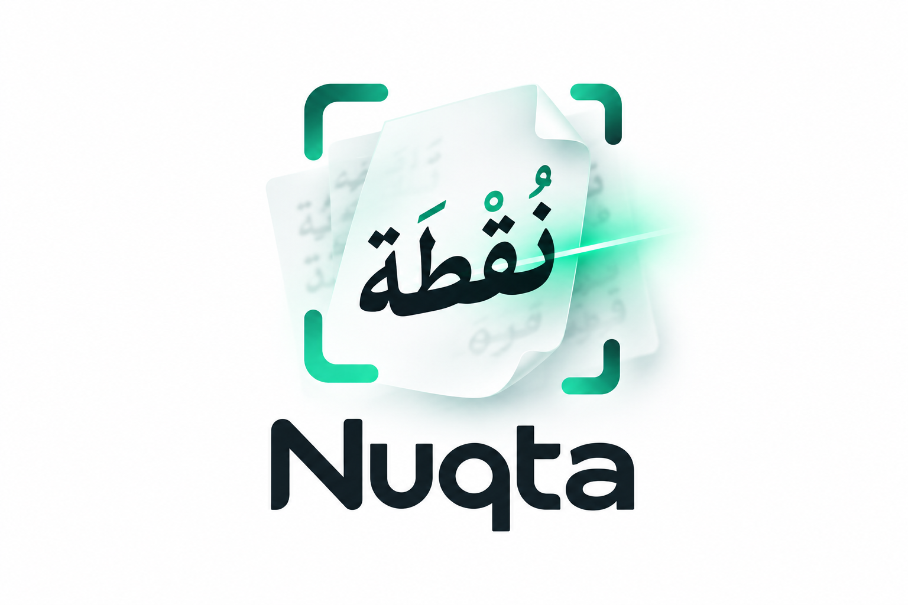

<p align="center"></p>

# Nuqta OCR: open-source Arabic OCR

Accurate Arabic document OCR with **faithful tashkeel**, in two open models: **Nuqta-Arabic-OCR 4B** (#1 on KITAB-Bench and Misraj-DocOCR among published results) and **Nuqta-Arabic-OCR 0.8B** (best for its size: ahead of Gemini-2.0-Flash on KITAB-Bench, just behind Misraj's Baseer v2 on Misraj-DocOCR, runs on phones).

- Reads books, scans, official documents, tables, IDs and passports
- Copies the tashkeel printed on the page and almost never adds any (0.08–0.16 invented marks per 100 letters)
- Markdown output with HTML tables, in reading order
- Runs on-premises on a single GPU, or fully offline on Android and iPhone: your documents never leave your network

[](https://colab.research.google.com/github/SalahAlHaismawi/nuqta-ocr/blob/main/examples/nuqta_quickstart.ipynb)
[](https://kaggle.com/kernels/welcome?src=https://github.com/SalahAlHaismawi/nuqta-ocr/blob/main/examples/nuqta_quickstart.ipynb)

Website: [https://salahalhaismawi.github.io/nuqta-ocr/](https://salahalhaismawi.github.io/nuqta-ocr/) · [Arabic OCR benchmarks compared](https://salahalhaismawi.github.io/nuqta-ocr/best-arabic-ocr/) · [guides](https://salahalhaismawi.github.io/nuqta-ocr/guides/) · [demo](https://huggingface.co/spaces/SalahALHaismawi/Nuqta-Arabic-OCR)

<div dir="rtl">

**بالعربية:** «نقطة» مكتبة ونماذج مفتوحة المصدر للتعرف الضوئي على النص العربي (OCR عربي). تحوّل صور الصفحات والمستندات الممسوحة
ضوئيًا وملفات PDF إلى نص أو Markdown، وتستخرج الجداول، وتقرأ البطاقات الشخصية وجوازات السفر، وتنقل التشكيل المطبوع كما هو.
النموذج 4B هو الأول على معياري KITAB-Bench وMisraj-DocOCR بين النتائج المنشورة. [جرّبه مجانًا](https://huggingface.co/spaces/SalahALHaismawi/Nuqta-Arabic-OCR).

</div>

## Install

```bash
pip install "nuqta-ocr[vllm]"   # recommended: fast, batched (Linux + NVIDIA GPU)
pip install "nuqta-ocr[fast]"   # transformers + fast kernels (no vLLM needed)
pip install nuqta-ocr           # transformers only (slow on long pages)
```

## Quick start

```python
from nuqta import OCR

if __name__ == "__main__":          # required with the vLLM backend (it starts worker processes)
    ocr = OCR("nuqta-0.8b")              # or "nuqta-4b" (most accurate)

    print(ocr.read("page.jpg").text)                        # as written: tashkeel only where printed
    print(ocr.read("scan.pdf", mode="markdown").text)       # headings, lists, HTML tables; every page
    print(ocr.read("passport.jpg", mode="id").fields)       # MRZ fields + check digits

    results = ocr.read_many(["a.jpg", "b.png", "c.pdf"])    # batched with vLLM
```

Command line:

```bash
nuqta read page.jpg
nuqta read scan.pdf --mode markdown
nuqta read passport.jpg --mode id --json
```

## Modes

| mode | output |
|---|---|
| `as-written` (default) | the text exactly as printed, tashkeel only where it is printed |
| `bare` | the text without any tashkeel |
| `markdown` | headings, paragraphs, lists and tables (HTML) in reading order |
| `id` | `markdown` reading + structured fields: passport / visa / ID-card MRZ with ICAO check digits; Egyptian national ID fields cross-checked against the national number |

## Line layout and hOCR

Line-level boxes enable searchable PDFs and hOCR. Install the optional
image-processing extras, then call `read_lines`:

```bash
pip install "nuqta-ocr[layout]"
nuqta read page.jpg --format hocr > page.hocr
```

```python
from nuqta import OCR, read_lines, to_hocr

ocr = OCR("nuqta-0.8b")
result = read_lines(ocr, ["page.jpg"])[0]
for line in result.pages[0].lines:
    print(line.bbox, line.text)
open("page.hocr", "w", encoding="utf-8").write(to_hocr(result))
```

The page is binarized (Otsu), lightly deskewed, and split into lines with a
horizontal projection profile; each line is cropped with a margin for
diacritics and read through the normal `OCR.read_many` API. `LineResult.pages`
holds the text, the boxes in the original image, and the page geometry needed
by hOCR. The core `OCR` class and its default output are unchanged.

Limits: single-column pages; word-level boxes are not predicted yet, so each
line is one `ocrx_word`; and Markdown and ID modes need the whole page and are
not supported by `read_lines`.

Speed and accuracy, measured on 67 single-column pages with ground truth (0.8B,
vLLM, RTX 5090 Laptop GPU): line mode reads about 1.7 points fewer words right
than a full-page read (95.3% vs 97.0%, tashkeel ignored; 84.8% vs 85.0% with
exact tashkeel), because each line is read without the rest of the page. On a
GPU it is faster for a single page (median 0.8 s vs 3.5 s), since all lines of
a page are batched together. For many pages at once a full-page read is faster
(67 pages: 41 s vs 56 s), because lines are batched one page at a time. On CPU
line mode is about the same speed as a full-page read.

## Use from Claude, Cursor and other MCP clients

`pip install "nuqta-ocr[mcp]"` adds `nuqta-mcp`, an MCP server with one tool, `read_document(path, mode, pages)`,
that reads an image or PDF on your computer in any of the modes above. The model loads on the first call (allow
a minute) and stays loaded. Set `NUQTA_MODEL=nuqta-4b` (or pass `--model nuqta-4b`) for the larger model.

Claude Code:

```bash
claude mcp add nuqta -- nuqta-mcp
```

Claude Desktop (`claude_desktop_config.json`) and Cursor (`~/.cursor/mcp.json`) use the same block:

```json
{
  "mcpServers": {
    "nuqta": { "command": "nuqta-mcp", "env": { "NUQTA_MODEL": "nuqta-0.8b" } }
  }
}
```

If the client cannot find `nuqta-mcp`, give its full path (`which nuqta-mcp`), or use
`"command": "uvx", "args": ["--from", "nuqta-ocr[mcp]", "nuqta-mcp"]`.

## What the library does for you

- **Page rule:** full pages are shown to the model at its training resolution (2.4 MP); word, line and card crops keep their size. Small page renders (e.g. 72-dpi PDF pages) otherwise lose letters.
- **Loop guard:** if a page reading repeats itself, the page is re-read at its native size; any repetition left is trimmed (`Page.looped` tells you).
- **PDFs:** every page rendered at 200 dpi.
- **ID checks:** a failed check digit or an inconsistent national number is reported, never silently "fixed". Send those fields to a human.

## On phones and laptops, offline

- **Android and iPhone apps:** [`apps/`](apps) has two small apps that run the 0.8B entirely on the phone (CPU on
  Android, GPU on iPhone), with the first words in about 2 seconds. Build steps are in [apps/README.md](apps/README.md).
- **GGUF for llama.cpp, LM Studio, Ollama and other local apps:**
  [Nuqta-Arabic-OCR-0.8B-GGUF](https://huggingface.co/SalahALHaismawi/Nuqta-Arabic-OCR-0.8B-GGUF) (560 MB at 4-bit) and
  [Nuqta-Arabic-OCR-4B-GGUF](https://huggingface.co/SalahALHaismawi/Nuqta-Arabic-OCR-4B-GGUF) (2.9 GB). The files carry the reading
  settings (greedy decoding, thinking off, a minimum image size), so most apps read well without setup; the cards
  list the settings to check in apps that override them.
- **Ollama:** runs straight from Hugging Face; put the image path in the prompt.

  ```bash
  ollama run --think=false hf.co/SalahALHaismawi/Nuqta-Arabic-OCR-0.8B-GGUF:Q4_K_M \
    "Transcribe the Arabic text in this image exactly as written. Include only the diacritics (tashkeel) that are visible in the image. ./page.jpg"
  ```

  Use `Nuqta-Arabic-OCR-4B-GGUF:Q4_K_M` for the 4B. Over the API, send the image in `images` with `"think": false`.
- **Desktop GUI for Windows (community project):** [nuqta-ocr-gui](https://github.com/hadi4172/nuqta-ocr-gui) is a
  gImageReader-style app that OCRs PDFs and images with the GGUF builds through llama.cpp, on an NVIDIA GPU or the CPU.
  It reads pages, regions or page ranges and exports text or a searchable PDF. It can also read everything with 0.8B and
  re-read only the low-confidence pages with 4B. The 4B Q4_K_M fits on an 8 GB GPU.

## Speed (0.8B, one 24 GB GPU)

| | vLLM | transformers + `[fast]` |
|---|---|---|
| text line | ~0.2 s | ~1 s |
| book page | ~3 s | ~3.5 s |
| markdown document page | ~3 s | ~6 s |

## Results

| | KITAB-Bench CER ↓ | Misraj-DocOCR MARS ↑ |
|---|---|---|
| **Nuqta-Arabic-OCR 4B** | **0.106** | **82.8** |
| **Nuqta-Arabic-OCR 0.8B** | **0.117** | 77.1 |
| Best other published result | 0.13 (Gemini-2.0-Flash) | 77.8 (Baseer v2, Misraj, Sept 2026) |

Recommended input size (what the library does). The 4B is first on both; the 0.8B is ahead of every other published
KITAB-Bench result and third on Misraj-DocOCR, just behind Baseer v2. Our Misraj-DocOCR scorer reproduces Misraj's own published
score for Qwen3-VL-8B to within a point (MARS 52.5 vs 51.8), and our exact predictions are in
[benchmarks/predictions](benchmarks/predictions/misraj_dococr) for anyone to re-score. Other models' figures are the ones published by
the KITAB-Bench authors and by Misraj ([Baseer paper](https://arxiv.org/abs/2509.18174),
[September 2026 results table](https://misraj.ai/en/blogs/baseer-arabic-document-ocr-vlm-misraj)).

Full tables, confidence intervals and disclosures are in the model cards; the full benchmarks are
[KITAB-Bench](https://github.com/mbzuai-oryx/KITAB-Bench) and [Misraj-DocOCR](https://huggingface.co/datasets/Misraj/Misraj-DocOCR).

## License

Code: Apache-2.0. Models: see their model cards.

## Contributors

Salah AlHaismawi · Mohamed Saleh Tulib · Ahmed ElSayed Mohamed Ibrahim
