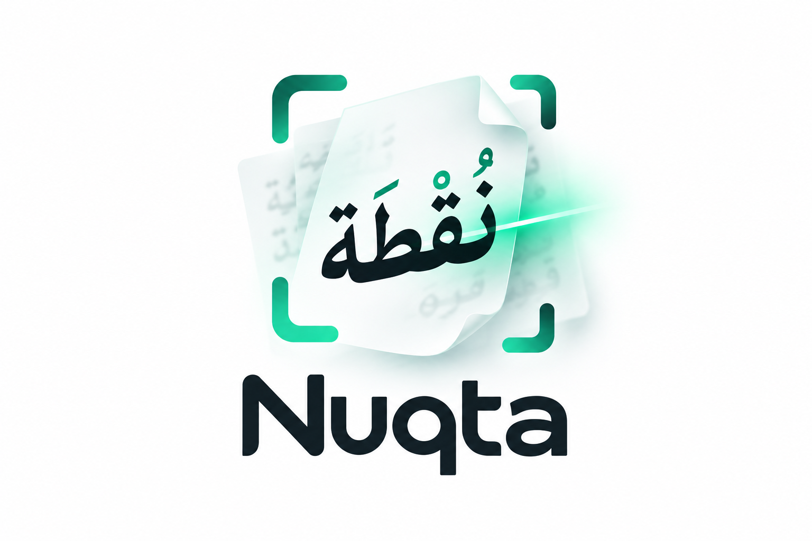

<p align="center"></p>

# Nuqta-Arabic-OCR 0.8B GGUF: Arabic OCR on phones and laptops

This repo holds the GGUF build of [Nuqta-Arabic-OCR-0.8B](https://huggingface.co/SalahALHaismawi/Nuqta-Arabic-OCR-0.8B) for
[llama.cpp](https://github.com/ggml-org/llama.cpp). It reads printed Arabic pages, copies the tashkeel that is
printed and almost never adds any. It runs fully offline in **about 1.6 GB of RAM**, on Android, iOS, Mac,
Windows and Linux, on CPU or GPU.

Website and guides: [https://salahalhaismawi.github.io/nuqta-ocr/](https://salahalhaismawi.github.io/nuqta-ocr/) · [run Arabic OCR offline](https://salahalhaismawi.github.io/nuqta-ocr/guides/run-arabic-ocr-offline/)

| File | Size | Use |
|---|---|---|
| `nuqta-ocr-0.8b-Q4_K_M.gguf` | 560 MB | **phones** (recommended) |
| `nuqta-ocr-0.8b-Q8_0.gguf` | 873 MB | laptops and desktops, closest to the original |
| `nuqta-ocr-0.8b-mmproj-f16.gguf` | 205 MB | vision encoder, **always needed** next to the model |

## Accuracy against the full model

We scored Q4_K_M (llama.cpp, CPU) against the bf16 model (vLLM) with the same prompts, image sizes and scoring:
greedy decoding, KITAB-Bench normalisation, character error rate (lower is better), on the same pages.

| KITAB-Bench set (first 40 images) | bf16 | Q4_K_M GGUF |
|---|---|---|
| Hindawi (book pages with tashkeel, at the recommended input size) | 0.031 | 0.028 |
| PATS-OCR (printed lines) | 0.009 | 0.014 |
| SynthesizeAR (synthetic lines) | 0.041 | 0.038 |
| Adab (poetry word crops) | 0.275 | 0.291 |

All differences are within page-to-page noise. On the full benchmarks the 0.8B model scores KITAB-Bench CER
0.117 and Misraj-DocOCR MARS 77.1: see the [main model card](https://huggingface.co/SalahALHaismawi/Nuqta-Arabic-OCR-0.8B).

## Run it

```bash
llama-mtmd-cli -m nuqta-ocr-0.8b-Q4_K_M.gguf --mmproj nuqta-ocr-0.8b-mmproj-f16.gguf \
  --image page.png --temp 0 -c 8192 --image-max-tokens 4096 \
  -p "Transcribe the Arabic text in this image exactly as written. Include only the diacritics (tashkeel) that are visible in the image."
```

Or serve an OpenAI-compatible API (one image plus the prompt per request):

```bash
llama-server -m nuqta-ocr-0.8b-Q4_K_M.gguf --mmproj nuqta-ocr-0.8b-mmproj-f16.gguf \
  -c 8192 --image-max-tokens 4096 --temp 0 --port 8080
```

Any app built on a recent llama.cpp with multimodal support (`mtmd`, Qwen3.5 architecture) can load these two
files. Tested with llama.cpp commit `5aeac37` (October 2026).

### Three settings that matter

1. **Use the recommended input size: enlarge full pages to about 2.4 megapixels.** The model was trained at that size, and a
   small page image costs real accuracy (on a 612×792 book page the reading went from many wrong words to
   almost perfect). The rule we use: if the image is page-shaped (long side ≤ 2× short side, short side ≥ 450
   px), scale it to 2.4 MP; leave line crops as they are; never go above 2.4 MP. On a slow phone, 1.2 MP is a
   reasonable compromise: about twice as fast, with a few more word errors.
2. **Pass `--image-max-tokens 4096`**, so llama.cpp doesn't shrink the page again.
3. **Set `-c 8192`.** The default context reserves about 5.5 GB of RAM; 8192 is enough for a full page and
   brings the total to about 1.6 GB.

The model may begin its answer with an empty `<think></think>` block: drop it.

### On your phone, as an app

[nuqta-ocr/apps](https://github.com/SalahAlHaismawi/nuqta-ocr/tree/main/apps) has ready-made Android and iPhone apps
that download these files once and read pages fully offline (first words in about 2 seconds with the 0.8B). They
handle the input size, read the page in strips and use the right settings for you.

### In chat apps (PocketPal, LM Studio, Jan, Ollama…)

These files carry Nuqta's reading settings, so llama.cpp-based apps pick them up without any setup: greedy decoding
(temperature 0, no repeat penalty), thinking switched off in the chat template, and a minimum image size of about
1 megapixel so small pages and photos are enlarged before reading. With no settings at all, this raised a small page
from 92.9% to 98.4% of characters right in our test, and stopped the model from writing `<think>`.

Some apps override these with their own defaults. If the output looks wrong, set them by hand:

| Setting | Value |
|---|---|
| Temperature | 0 |
| Top-K | 1 |
| Repeat / frequency / presence penalty | off (1.0 / 0 / 0) |
| Context length | 8192 |
| Max new tokens | 4096 |
| System prompt | none |
| Thinking / reasoning | off |

Send the image together with one of the prompts below in the same message. For the best accuracy on whole pages,
use the [nuqta-ocr](https://github.com/SalahAlHaismawi/nuqta-ocr) library, which also applies the recommended input size.

### Prompts

| Mode | Prompt |
|---|---|
| as written (default) | `Transcribe the Arabic text in this image exactly as written. Include only the diacritics (tashkeel) that are visible in the image.` |
| no tashkeel | `Transcribe the Arabic text in this image without any diacritics.` |
| Markdown (tables, headings) | `Convert this document to Markdown: headings, paragraphs, lists and tables in reading order. Include only the diacritics visible in the image.` |

## Speed

Measured on a laptop CPU (8 threads, no GPU) with Q4_K_M, for one full book page:

| Page size | Image encoding | Total |
|---|---|---|
| 2.4 MP | 18 s | 39 s |
| 1.2 MP | 6 s | 21 s |

A text line takes about 2 s. A phone CPU is slower than this. A phone GPU (Metal on iPhone, Vulkan or OpenCL on
Android) is usually much faster, especially for the image encoding step.

## Limitations

Tables: the 0.8B may reorder or drop columns, especially in small mixed Arabic / English tables that start with an
English column (every cell is still read correctly). Use the [4B GGUF](https://huggingface.co/SalahALHaismawi/Nuqta-Arabic-OCR-4B-GGUF)
for tables. Full limitations: [Nuqta-Arabic-OCR-0.8B](https://huggingface.co/SalahALHaismawi/Nuqta-Arabic-OCR-0.8B#limitations).

## Contributors

Salah AlHaismawi · Mohamed Saleh Tulib · Ahmed ElSayed Mohamed Ibrahim

## License

Apache 2.0, like the original model. Built on [Qwen3.5-0.8B](https://huggingface.co/Qwen/Qwen3.5-0.8B).

## Citation

```bibtex
@misc{nuqta_ocr_2026,
  title  = {Nuqta OCR: Accurate Arabic Document OCR with Faithful Tashkeel},
  author = {Salah AlHaismawi and Mohamed Saleh Tulib and Ahmed ElSayed Mohamed Ibrahim},
  year   = {2026},
  url    = {https://huggingface.co/SalahALHaismawi/Nuqta-Arabic-OCR-0.8B-GGUF}
}
```
