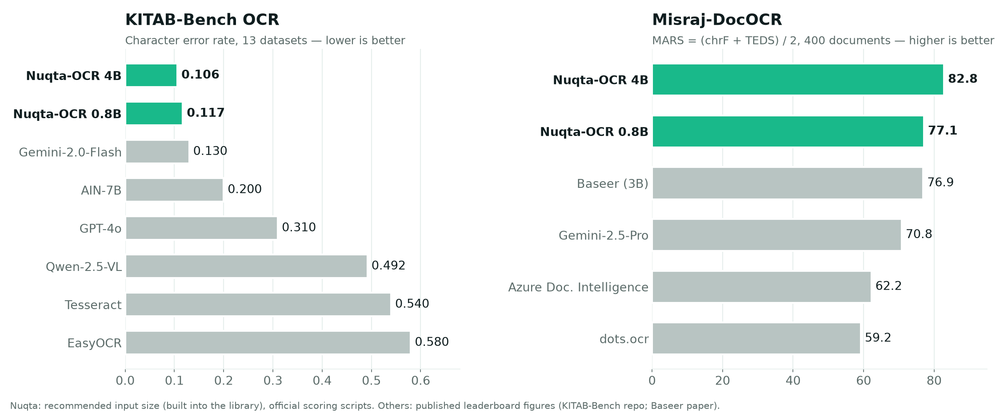

<p align="center"></p>

# Nuqta-Arabic-OCR 4B

Open-source **Arabic OCR** model, **first on KITAB-Bench and Misraj-DocOCR** among published results. It is the most accurate model in the Nuqta OCR family.

**Nuqta-Arabic-OCR 4B** is an open-weights **Arabic OCR** model. It converts Arabic scans, photos and PDFs (books, official
documents, research papers, tables, forms, IDs and passports) into clean text or Markdown with HTML tables, in reading
order, and it **copies the tashkeel printed on the page and almost never adds any** (0.08–0.16 invented marks per 100
letters on undiacritized text).

Part of the [Nuqta OCR](https://huggingface.co/collections/SalahALHaismawi/nuqta-ocr-6ad4af255195b706ac93d1d4) family ·
[Nuqta-Arabic-OCR 0.8B](https://huggingface.co/SalahALHaismawi/Nuqta-Arabic-OCR-0.8B) · [demo](https://huggingface.co/spaces/SalahALHaismawi/Nuqta-Arabic-OCR) ·
[website](https://salahalhaismawi.github.io/nuqta-ocr/) · [library and benchmark code](https://github.com/SalahAlHaismawi/nuqta-ocr) · Apache-2.0

**Contributors:** Salah AlHaismawi · Mohamed Saleh Tulib · Ahmed ElSayed Mohamed Ibrahim

<div dir="rtl">

### نقطة: نموذج مفتوح المصدر للتعرف الضوئي على النص العربي (OCR عربي)

يحوّل «نقطة» صور الصفحات والمستندات الممسوحة ضوئيًا وملفات PDF العربية إلى نص أو Markdown، ويستخرج الجداول بصيغة HTML،
ويقرأ البطاقات الشخصية وجوازات السفر. وهو الأول على معياري KITAB-Bench (معدل خطأ الحروف 0.106) وMisraj-DocOCR (‏MARS 82.8) بين النتائج المنشورة، متقدمًا على Gemini وGPT-4o وBaseer.

- ينقل التشكيل المطبوع في الصفحة كما هو، ونادرًا ما يضيف تشكيلًا غير موجود فيها.
- مفتوح المصدر برخصة Apache-2.0، ويعمل على أجهزتك فلا تخرج مستنداتك من شبكتك.
- يعمل على بطاقة رسومية بذاكرة 16 جيجابايت، أو دون اتصال على الحاسوب بصيغة GGUF.

[جرّبه مجانًا](https://huggingface.co/spaces/SalahALHaismawi/Nuqta-Arabic-OCR) · `pip install nuqta-ocr`

</div>

## Highlights

- **KITAB-Bench: CER 0.106**, against Gemini-2.0-Flash 0.13, AIN-7B 0.20 and GPT-4o 0.31 (13 Arabic OCR datasets; 0.111 with the images as given).
- **Misraj-DocOCR: MARS 82.8** (81.0 with the images as given), chrF 89.4, CER 0.121, ahead of Misraj's own Baseer v2 (77.8), Gemini-2.5-Pro (70.8) and GPT-5 (54.8).
- **Faithful tashkeel:** 0.16 invented diacritics per 100 letters on undiacritized text, and vocalized pages keep their marks.
- **Tables** as HTML in the order they are drawn (left-to-right or right-to-left), merged cells included; column order right on 98% / 98% of rendered mixed-direction test tables.
- **IDs and passports:** 85.7% of fields correct on real ID cards and 87.2% on real passports (held-out, no training overlap), with ICAO check-digit validation of the MRZ.
- **Stable:** essentially no repetition loops; the `nuqta-ocr` library adds a loop guard on top.
- **Open and on-premises:** your documents never leave your network. Serves comfortably on a 16 GB GPU in bf16 (about 1.8 s per document page in batched vLLM serving); GGUF builds for llama.cpp: [Nuqta-Arabic-OCR-4B-GGUF](https://huggingface.co/SalahALHaismawi/Nuqta-Arabic-OCR-4B-GGUF).

<p align="center"></p>

## Examples

Real outputs of Nuqta-Arabic-OCR 4B, through the `nuqta-ocr` library. Sources: a Hindawi book page (CC BY 4.0), a
Misraj-DocOCR page (Apache-2.0), and a synthetic passport and diagram we generated (no real person's document).


## Benchmarks

All Nuqta numbers are our runs, scored with **KITAB-Bench's own scoring code** (copied unchanged). Misraj published no scoring code, so for Misraj-DocOCR we follow the recipe in the Baseer paper (§7.1) on top of that same code; competitor numbers are the published
figures. For the full benchmarks, every subset and the other models' results, see
[KITAB-Bench](https://github.com/mbzuai-oryx/KITAB-Bench) and
[Misraj-DocOCR](https://huggingface.co/datasets/Misraj/Misraj-DocOCR) (leaderboard in the
Baseer paper, updated in [Misraj's September 2026 results table](https://misraj.ai/en/blogs/baseer-arabic-document-ocr-vlm-misraj)). *Recommended input size* = how the model is meant to be
used, and what the `nuqta-ocr` library, the demo and the code below do: a page-shaped image smaller than the model's
2.4-megapixel training size is enlarged to it, while line and word crops are read as they are. *Images as given* =
each test image sent to the model unchanged (apart from the same 2.4 MP cap). Evaluation code to reproduce every number: [nuqta-ocr/benchmarks](https://github.com/SalahAlHaismawi/nuqta-ocr/tree/main/benchmarks).

### KITAB-Bench: OCR track (13 datasets, 3,760 images), character error rate ↓

With the recommended input size only the Hindawi pages change (they are small 612x792 page renders); the other 12 datasets are crops or full-size pages, read as given.

| Model | Size | CER |
|---|---|---|
| **Nuqta-Arabic-OCR 4B**, recommended input size | 4.75B | **0.106** |
| Nuqta-Arabic-OCR 4B, images as given | 4.75B | 0.111 (95% CI 0.105-0.118) |
| Gemini-2.0-Flash | closed | 0.130 |
| AIN-7B | 7B | 0.200 |
| GPT-4o | closed | 0.310 |
| Qwen-2.5-VL | 7B | 0.492 |
| Tesseract | - | 0.540 |
| EasyOCR | - | 0.580 |

<details><summary><b>Every KITAB-Bench dataset (Nuqta-Arabic-OCR 4B, images as given)</b></summary>

| Dataset | CER |
|---|---|
| Adab (word crops) | 0.226 |
| ArabicOCR (lines) | 0.021 |
| EvArEST (scene text) | 0.136 |
| Hindawi (book pages) | 0.090 |
| Historical books | 0.122 |
| HistoryAr (manuscripts) | 0.177 |
| ISI-PPT (slides) | 0.032 |
| KHATT (handwritten lines) | 0.107 |
| KHATT paragraphs | 0.067 |
| Muharaf (manuscripts) | 0.282 |
| Online-KHATT | 0.135 |
| PATS (fonts) | 0.011 |
| SynthesizeAr (synthetic) | 0.036 |

Hindawi's small 612x792 page renders are read far better at the recommended input size (CER 0.029).
</details>

**Contamination disclosure.** 234 KITAB test images (all 200 KHATT-paragraph pages, the 10 HistoricalBooks pages,
13 Muharaf and 11 KHATT-line images) also appear in public datasets we trained on. Without them the macro CER is
**0.113** (11 datasets, images as given). PATS-OCR is scored on all 500 lines, including 114 whose text
also appears in our training data (scores are the same or better without them). Misraj-DocOCR has no such overlap.

### Misraj-DocOCR (400 real Arabic document pages)

| Model | Size | CER ↓ | WER ↓ | BLEU ↑ | chrF ↑ | TEDS ↑ | MARS ↑ |
|---|---|---|---|---|---|---|---|
| **Nuqta-Arabic-OCR 4B**, recommended input size | 4.75B | 0.121 | 0.246 | 68.4 | 89.4 | **76.1** | **82.8** |
| Nuqta-Arabic-OCR 4B, images as given | 4.75B | 0.161 | - | - | 87.6 | 74.4 (95% CI 67.4-81.1) | 81.0 |
| Baseer v2 (Misraj, September 2026) | not stated | **0.12** | **0.19** | 76.3 | 88.9 | 67 | 77.8 |
| Baseer (paper) | 3B | 0.53† | 0.25 | - | 87.8 | 66 | 76.9 |
| Gemini-2.5-Pro | closed | 0.31 | 0.37 | **77.9** | **89.6** | 52 | 70.8 |
| Azure Document Intelligence | closed | 0.27 | 0.44 | 62.0 | 82.5 | 42 | 62.2 |
| dots.ocr | 3B | 0.40 | 0.50 | 58.2 | 78.4 | 40 | 59.2 |
| GPT-5 | closed | 0.62 | 0.86 | 40.7 | 61.6 | 48 | 54.8 |
| Mistral OCR | closed | 0.42 | 0.49 | 52.4 | 71.8 | 17 | 44.4 |
| QARI | - | 0.64 | 0.76 | 38.6 | 64.5 | 21 | 42.8 |

Bold = best in each column. Every other model's numbers are Misraj's: the Baseer paper and their September 2026
results table, which added Baseer v2 (no public weights that we could find; its demo is baseerocr.com) and GPT-5. The 4B has the best MARS and TEDS; Baseer v2 has the lowest CER and WER, and Gemini-2.5-Pro the best BLEU and chrF.

† As printed in the Baseer paper. It is higher than Baseer's own WER (0.25), unlike every other row of that
table, so it was probably computed with different text cleanup; Baseer's weights are not public, so we could not
re-score it, and we make no CER comparison with Baseer.

TEDS rests on 59 table pages and moves by several points between comparable models; MARS = (chrF + TEDS) / 2.
Tables written where the reference has one: 56 / 59.

**Scorer check.** Misraj's scoring code is not public, so we checked ours against a row they did publish. We ran
Qwen3-VL-8B-Instruct on all 400 pages with a plain Markdown prompt. Our scorer gives it chrF 54.7, TEDS 50.3 and MARS
52.5, against Misraj's 54.5, 49 and 51.8. Each part lands within about a point, so the numbers in this table are on
Misraj's scale. Our exact predictions for every Nuqta number, and for this check, are in
[benchmarks/predictions](https://github.com/SalahAlHaismawi/nuqta-ocr/tree/main/benchmarks/predictions/misraj_dococr)
for anyone to score with their own code.

### Beyond the benchmarks

| | Nuqta-Arabic-OCR 4B |
|---|---|
| Invented diacritics on undiacritized text | 0.16 per 100 letters |
| Table column order, rendered mixed-direction web tables (left-to-right / right-to-left) | 98% / 98% correct |
| Diagrams (KITAB diagrams, boxes read intact, in reading order) | 90.9% |
| Real ID cards, fields correct (held-out) | 85.7% |
| Real passports, fields correct / MRZ valid | 87.2% / 85.7% |
| Privacy check: training ID numbers reproduced on other cards | 0 of 634 numbers |

**Urdu and Jawi, never trained on.** Nuqta was trained for Arabic (and the English printed alongside it), not for
Urdu or Jawi, but it still reads them. On a page rendered from an Urdu Wikipedia article (Naskh type) the 4B gets 93% of characters right; it
mostly confuses Urdu-only letter forms (it reads ہ as ب, and writes Arabic ي / ك for Urdu ی / ک). Nastaliq, the usual Urdu
book and newspaper style, is harder (87%). On a page rendered from a Malay news article written in Jawi it gets 94%; nearly
every miss is a letter Arabic does not have (ڤ read as ق, ڠ as ڭ, ڬ as ك). These are single-page spot checks with the
default prompt, not benchmarks.

## What makes Nuqta different

**Architecture: a deeper attention stack.** Nuqta builds on [Qwen/Qwen3.5-4B](https://huggingface.co/Qwen/Qwen3.5-4B), a
vision-language model whose decoder mixes linear-attention layers (Gated DeltaNet) with a few full-attention layers
(8 of 32). Reading a dense Arabic page means relating every letter and diacritic to text
far away on the page, which is what full attention does best, so we **grew the decoder by two extra full-attention
layers** (after decoder layers 15 and 31): **34 layers, 10 with full attention**. The new layers start as an exact
identity (zero-initialised output projections), so the pretrained model is undisturbed at step 0, and they train at
twice the learning rate of the rest of the decoder.

| | |
|---|---|
| Parameters | 4.75B (0.33B vision encoder) |
| Decoder | 34 layers (10 full attention, of which 2 added; 24 linear attention), hidden size 2560 |
| Input | images up to 2.4 megapixels; PDFs page by page |
| Output | up to 8,192 tokens: text or Markdown with HTML tables |
| Modes | as written · without tashkeel · Markdown · ID fields |

**Data: exact labels, not guesses.** Training pages come with labels that are exact by construction or verified:
born-digital documents and PDF text layers, rendered books and web pages, official gazettes, real scans aligned to
their source text, real and synthetic tables with HTML labels, forms, receipts, ID cards and passports, diagrams with
block-ordered labels, and handwritten pages, across 172 sources. Labels from automatic readers were only kept where
independent readings agreed. All benchmark test sets were excluded from training (see the disclosure above for the
public-dataset overlap we found afterwards).

**Where the ID and passport data comes from.** Real cards and passports: 7,846 images from 64 public
[Roboflow Universe](https://universe.roboflow.com) projects, by licence 7,384 CC BY 4.0, 314 MIT, 128 public domain,
and 20 from two projects with no open licence stated. Their text labels were kept only where the MRZ check
digits or two independent readings agreed. Also used: [MIDV-LAIT](https://doi.org/10.1007/978-3-030-86331-9_17) (mock
documents with synthetic holders, CC BY-SA 2.5) and our own synthetic cards and passports for 18 countries. The
evaluation cards are held out (no image or holder overlap), and a privacy test checks that the model does not
reproduce training ID numbers on other cards (0 of 634 reproduced).

**Training.** 20,000 steps from Qwen3.5-4B (effective batch 64 on 4 GPUs, AdamW 8-bit, peak LR 1e-5 for the decoder and 1e-6 for the vision encoder, warmup-stable-decay schedule); from step 15,000 a curated annealing mix (verified real pages, tables, IDs, layouts) while the learning rate decays to zero. The released 4B is the end of this supervised stage: a reinforcement-learning round (same recipe as the 0.8B) scored slightly better on KITAB but worse on Misraj tables at release resolution, so it was not shipped. Compute: 4 NVIDIA RTX PRO 6000 GPUs (96 GB each).

**Faithful tashkeel by design.** Every training page is labelled with exactly the diacritics printed on it, so the
model learns to copy tashkeel, not to add it.

## How to use

With 🤗 Transformers:

```python
import torch
from PIL import Image
from transformers import AutoModelForImageTextToText, AutoProcessor

repo = "SalahALHaismawi/Nuqta-Arabic-OCR-4B"
processor = AutoProcessor.from_pretrained(repo)
model = AutoModelForImageTextToText.from_pretrained(repo, dtype=torch.bfloat16, device_map="auto")

def prepare(im):  # recommended input size: pages to the 2.4 MP training size, crops as they are, all capped at 2.4 MP
    w, h = im.size
    page = max(w, h) <= 2 * min(w, h) and min(w, h) >= 450
    if page or w * h > 2_400_000:
        k = (2_400_000 / (w * h)) ** 0.5
        im = im.resize((max(32, int(w * k)), max(32, int(h * k))), Image.LANCZOS)
    return im

prompt = "Transcribe the Arabic text in this image exactly as written. Include only the diacritics (tashkeel) that are visible in the image."
messages = [{"role": "user", "content": [{"type": "image", "image": prepare(Image.open("page.jpg").convert("RGB"))}, {"type": "text", "text": prompt}]}]
inputs = processor.apply_chat_template(messages, add_generation_prompt=True, tokenize=True, return_dict=True,
                                       return_tensors="pt", enable_thinking=False).to(model.device)
out = model.generate(**inputs, max_new_tokens=8192, do_sample=False)
print(processor.decode(out[0, inputs["input_ids"].shape[1]:], skip_special_tokens=True))
```

With vLLM: `vllm serve SalahALHaismawi/Nuqta-Arabic-OCR-4B`, then send the `prepare`d image and prompt to the OpenAI-compatible chat endpoint with
`temperature 0` and `chat_template_kwargs: {"enable_thinking": false}`.

### With the nuqta-ocr library

The library adds page enlarging, PDF input, the loop guard and ID field parsing:

```bash
pip install "nuqta-ocr[vllm]"      # or "nuqta-ocr[fast]" for transformers with fast kernels
```

```python
from nuqta import OCR

if __name__ == "__main__":
    ocr = OCR("nuqta-4b")
    print(ocr.read("page.jpg").text)                       # as written: tashkeel only where printed
    print(ocr.read("scan.pdf", mode="markdown").text)      # headings, lists, HTML tables; every page
    print(ocr.read("passport.jpg", mode="id").fields)      # MRZ fields + check digits
```

Command line: `nuqta read scan.pdf --mode markdown --model nuqta-4b`.

### Prompts and settings

Use the prompts below with the model's chat template (thinking disabled, greedy decoding, stop tokens `<|im_end|>`
and `<|endoftext|>`). The snippet above already applies the recommended input size: page-shaped images
(aspect ratio ≤ 2, short side ≥ 450 px) resized to about 2.4 megapixels, crops kept at their size, every image capped
at 2.4 MP. (The `nuqta-ocr` library also re-reads a page at its native size if the first reading repeats itself.)

| Mode | Prompt |
|---|---|
| as-written | `Transcribe the Arabic text in this image exactly as written. Include only the diacritics (tashkeel) that are visible in the image.` |
| bare | `Transcribe the Arabic text in this image without any diacritics.` |
| markdown | `Convert this document to Markdown: headings, paragraphs, lists and tables in reading order. Include only the diacritics visible in the image.` |

## Limitations

- Handwriting is usable (KITAB KHATT lines CER 0.107) but less reliable than print, and historical manuscripts are
  weak (Muharaf 0.282); on unclear handwriting the model can substitute a familiar word for a rare one.
- Decorative calligraphy is not supported, and on Quranic or calligraphic script the model can add marks that are
  not printed (for example on hamzat al-wasl).
- ID and passport fields should be reviewed by a person; `id` mode reports failed check digits and inconsistent
  national numbers instead of correcting them.
- Dotted leader lines in tables of contents are not copied.
- On two handwriting / manuscript sets of KITAB-Bench the 4B is slightly behind the 0.8B (Muharaf 0.282 vs 0.270, Online-KHATT 0.135 vs 0.126).


## References

- *KITAB-Bench: A Comprehensive Multi-Domain Benchmark for Arabic OCR and Document Understanding* (MBZUAI, 2025) ·
  [code and leaderboard](https://github.com/mbzuai-oryx/KITAB-Bench)
- *Misraj-DocOCR* · [dataset](https://huggingface.co/datasets/Misraj/Misraj-DocOCR); evaluation recipe and leaderboard
  in the *Baseer* paper (Misraj AI, 2025)
- Base model: [Qwen3.5](https://huggingface.co/Qwen)

## Contributors

- **Salah AlHaismawi**
- **Mohamed Saleh Tulib**
- **Ahmed ElSayed Mohamed Ibrahim**

## License

Apache-2.0.

## Citation

```bibtex
@misc{nuqta_ocr_2026,
  title  = {Nuqta OCR: Accurate Arabic Document OCR with Faithful Tashkeel},
  author = {Salah AlHaismawi and Mohamed Saleh Tulib and Ahmed ElSayed Mohamed Ibrahim},
  year   = {2026},
  url    = {https://huggingface.co/SalahALHaismawi/Nuqta-Arabic-OCR-4B}
}
```
